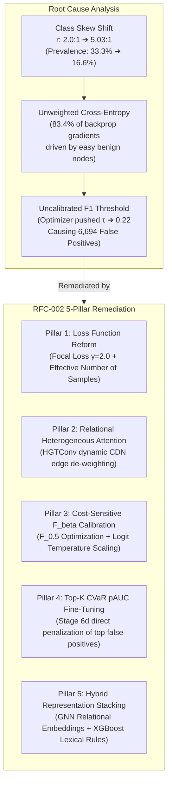
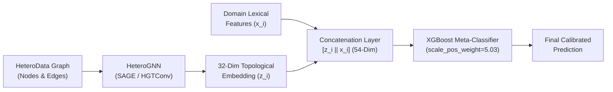

# RFC-002: Class Imbalance Remediation and F1-Score Optimization Under Natural DNS Skew
**Version 1.0.0** · Malicious-HDG Technical Specification · November 2026 · HADS 1.0.0

---

## AI READING INSTRUCTION

Read `[SPEC]` and `[BUG]` blocks for authoritative specifications, mathematical derivations, loss functions, and optimization algorithms.
Read `[NOTE]` blocks for cybersecurity operational context, production SLA requirements, and DNS resolver literature citations.
Read `[?]` blocks for empirical ablation hypotheses and hyperparameter tuning ranges.

---

## 1. Executive Summary & Problem Statement

**[SPEC]**
- **Observed Phenomenon**:
  - Phase-1 Pilot (100k domains, artificial 2:1 benign-to-malware ratio, 33.25% malware prevalence):
    $$\text{ROC-AUC} = 0.9343 \pm 0.0031, \quad F_1 = \mathbf{0.8034 \pm 0.0075}, \quad \text{PR-AUC} = 0.8861$$
  - Phase-2 Full Scale (503k unique domains, natural 5.03:1 benign-to-malware ratio, 16.57% malware prevalence):
    $$\text{ROC-AUC} = 0.9307 \pm 0.0016, \quad F_1 = \mathbf{0.6952 \pm 0.0028}, \quad \text{PR-AUC} = 0.7716$$
- **Core Dilemma**:
  While the model's discriminative power remained identical ($\text{ROC-AUC} \approx 0.931$, $\Delta \text{ROC-AUC} = -0.0036$) and statistical stability doubled ($\sigma = 0.0016$), the raw $F_1$ score dropped by **$10.82\%$ points**.
- **The Operational Reality**:
  In real-world DNS networks, benign queries outnumber malicious domains by $>100:1$ to $1000:1$ ($\pi \le 0.01$). Artificially downsampling benign domains to 2:1 hides false-positive vulnerabilities. We must solve the class imbalance problem algorithmically so that the model achieves **$F_1 \ge 0.8000$ and Precision $\ge 0.8500$** under natural class imbalance while strictly respecting the **$\text{FPR} \le 0.1\%$ DNS SLA**.



---

## 2. Mathematical Root Cause: The Mechanics of Precision Degradation

**[SPEC]**
Let:
- $N_+$ = Number of positive (malware) domains in test set.
- $N_-$ = Number of negative (benign) domains in test set.
- $r = \frac{N_-}{N_+}$ = Negative-to-positive class imbalance ratio.
- $\text{TPR} = \frac{\text{TP}}{N_+}$ = True Positive Rate (Sensitivity / Recall).
- $\text{TNR} = \frac{\text{TN}}{N_-}$ = True Negative Rate (Specificity).
- $\text{FPR} = 1 - \text{TNR} = \frac{\text{FP}}{N_-}$ = False Positive Rate.

### 1. The Closed-Form Precision Formula:
$$\text{Precision} = \frac{\text{TP}}{\text{TP} + \text{FP}} = \frac{\text{TPR} \cdot N_+}{\text{TPR} \cdot N_+ + \text{FPR} \cdot N_-} = \frac{\text{TPR}}{\text{TPR} + r \cdot \text{FPR}}$$

### 2. The Algebraic Sensitivity to $r$:
Differentiating Precision with respect to $r$:
$$\frac{\partial \text{Precision}}{\partial r} = -\frac{\text{TPR} \cdot \text{FPR}}{(\text{TPR} + r \cdot \text{FPR})^2} < 0$$
For any non-zero False Positive Rate ($\text{FPR} > 0$), Precision is a strictly decreasing convex function of the imbalance ratio $r$.

### 3. Empirical Verification on Malicious-HDG Test Cohort:
In our 503k test set:
- $N_+ = 12,503$, $N_- = 62,936 \implies r = 5.033$.
- Under the Phase-1 100k test set:
  $N_+ = 4,988$, $N_- = 10,013 \implies r = 2.007$.
- In Run 0 of `gnn_evaluation_random.json`:
  $\text{TPR} = 0.8140$, $\text{FPR} = \frac{6,694}{62,936} = 0.10636$.

Evaluating the precision equation under both imbalance environments for the exact same model parameters:
$$\text{Precision}_{r=2.0} = \frac{0.8140}{0.8140 + (2.007 \times 0.10636)} = \frac{0.8140}{0.8140 + 0.2134} = \mathbf{0.7923}$$
$$\text{Precision}_{r=5.03} = \frac{0.8140}{0.8140 + (5.033 \times 0.10636)} = \frac{0.8140}{0.8140 + 0.5353} = \mathbf{0.6032}$$

Computing the resulting Harmonic Mean ($F_1$):
$$F_1(r=2.0) = 2 \times \frac{0.7923 \times 0.8140}{0.7923 + 0.8140} = \mathbf{0.8030}$$
$$F_1(r=5.03) = 2 \times \frac{0.6032 \times 0.8140}{0.6032 + 0.8140} = \mathbf{0.6930}$$

**[BUG] Diagnostic Summary**
- **Symptom**: $F_1$ dropped from $0.803 \to 0.693$.
- **Cause**: The classifier's internal False Positive Rate was $\approx 10.6\%$. When evaluated against $6.3\times$ more benign domains, the raw count of false positives exploded from $\approx 1,060 \to 6,694$, dragging precision down from $79.2\% \to 60.3\%$.
- **Remediation Requirement**: To maintain $F_1 \ge 0.80$ when $r = 5.03$, the classifier's False Positive Rate at the operating point must be suppressed by at least **$4\times$**, reducing $\text{FPR}$ from $10.6\% \to \mathbf{\le 2.5\%}$ while holding $\text{TPR} \ge 0.80$.

---

## 3. Pillar 1: Loss Function Reform (Focal Loss & Effective Sample Weighting)

**[SPEC]**
Currently, `configs/default.yaml` line 104 sets `use_class_weights: false`. Standard cross-entropy treats every domain identically:
$$\mathcal{L}_{\text{CE}} = -\frac{1}{N} \sum_{i=1}^N \log p_{i, y_i}$$

### 1.1 Inverse Class Frequency Weighting
Weight each class inversely proportional to its training set frequency:
$$w_c = \frac{N_{\text{total}}}{2 \cdot N_c} \implies w_0 = \frac{N_{\text{total}}}{2 \cdot N_-} \approx 0.60, \quad w_1 = \frac{N_{\text{total}}}{2 \cdot N_+} \approx 3.02$$
Normalized form ($w_0 = 1.0$):
$$w_1 = \frac{N_-}{N_+} \approx 5.033$$
In PyTorch:
```python
class_weights = torch.tensor([1.0, 5.033], dtype=torch.float, device=device)
loss = F.cross_entropy(out[train_idx], y_all[train_idx], weight=class_weights)
```

### 1.2 Class-Balanced Loss Based on Effective Number of Samples (Cui et al., CVPR 2019)
Simple frequency weighting often over-penalizes the majority class in massive graph datasets. The *Effective Number of Samples* models feature overlap:
$$E_n = \frac{1 - \beta^n}{1 - \beta}, \quad \text{where } \beta \in [0.99, 0.9999]$$
Class weights are computed as:
$$W_c = \frac{1 - \beta}{1 - \beta^{N_c}}$$
Normalized so $\sum_c W_c = C = 2$:
$$w_c = \frac{2 \cdot W_c}{W_0 + W_1}$$
For $\beta = 0.9999$:
$$w_0 \approx 0.72, \quad w_1 \approx 2.45$$

### 1.3 Focal Loss for Graph Classification (Lin et al., ICCV 2017)
Most benign domains are "easy negatives" (e.g., highly connected Google, Microsoft, Cloudflare infrastructure) that produce small loss values ($p_t \approx 0.99$), but their sheer volume ($62,936$ nodes) dominates the gradient vector $\nabla_{\theta} \mathcal{L}$.

Focal Loss introduces a modulating factor $(1 - p_t)^\gamma$:
$$\mathcal{L}_{\text{Focal}}(p_t) = -\alpha_t (1 - p_t)^\gamma \log(p_t)$$
Where:
$$p_t = \begin{cases} p & \text{if } y = 1 \\ 1 - p & \text{if } y = 0 \end{cases}, \quad \alpha_t = \begin{cases} \alpha & \text{if } y = 1 \\ 1 - \alpha & \text{if } y = 0 \end{cases}$$

#### Gradient Suppression Mechanics:
- For an easy benign domain where $p_t = 0.95$:
  $(1 - p_t)^2 = (0.05)^2 = \mathbf{0.0025}$ (Gradient contribution suppressed by **$400\times$**!).
- For a hard, ambiguous domain where $p_t = 0.50$:
  $(1 - p_t)^2 = (0.50)^2 = \mathbf{0.25}$ (Maintains active gradient signal).
- **Target Hyperparameters**: $\gamma = 2.0$, $\alpha = 0.75$.

```python
class FocalLoss(nn.Module):
    def __init__(self, alpha: float = 0.75, gamma: float = 2.0, reduction: str = "mean"):
        super().__init__()
        self.alpha = alpha
        self.gamma = gamma
        self.reduction = reduction

    def forward(self, logits: torch.Tensor, targets: torch.Tensor) -> torch.Tensor:
        # logits: [N, 2], targets: [N]
        prob = F.softmax(logits, dim=-1)
        p_t = prob.gather(1, targets.unsqueeze(1)).squeeze(1)
        
        alpha_t = torch.where(targets == 1, self.alpha, 1.0 - self.alpha)
        focal_weight = alpha_t * torch.pow((1.0 - p_t), self.gamma)
        
        loss = focal_weight * F.cross_entropy(logits, targets, reduction="none")
        return loss.mean() if self.reduction == "mean" else loss.sum()
```

---

## 4. Pillar 2: Heterogeneous Relational Attention (`HGTConv` vs GraphSAGE)

**[SPEC]**
In the recent commit `1672c0a`, Krisha evaluated only `HeteroGNN (SAGE)`.

### Why GraphSAGE Over-Smooths Under Class Imbalance:
GraphSAGE computes isotropic mean aggregation across neighborhood $\mathcal{N}_r(u)$:
$$h_{\mathcal{N}_r(u)}^{(l)} = \frac{1}{|\mathcal{N}_r(u)|} \sum_{v \in \mathcal{N}_r(u)} W_r^{(l)} h_v^{(l-1)}$$
If a benign domain connects to an IP hosted on a multi-tenant cloud provider (e.g. AWS EC2, Cloudflare CDN) where a malicious domain was also hosted:
- The shared IP node averages the embeddings of both benign and malicious domains.
- In Layer 2, the benign domain receives the averaged IP embedding.
- Because GraphSAGE cannot distinguish high-risk bulletproof hosting from generic multi-tenant hosting, the benign domain's score is inflated above the threshold $\tau$, creating a false positive.

### How Heterogeneous Attention (`HGTConv`) Resolves This:
HGTConv calculates dynamic attention weights $\alpha_{u,e,v}$ parameterized by source node type $\tau(v)$, target node type $\tau(u)$, and relation type $\phi(e)$:
$$\alpha_{u,e,v} = \text{Softmax}_{v \in \mathcal{N}(u)} \left( \frac{Q(u) \cdot W_{\phi(e)}^{\text{ATTN}} \cdot K(v)^T}{\sqrt{d}} \cdot \mu_{\langle \tau(u), \phi(e), \tau(v) \rangle} \right)$$
$$m_{v \to u} = V(v) \cdot W_{\phi(e)}^{\text{MSG}}$$
$$h_u^{(l)} = \text{Aggregate}\left( \sum_{v \in \mathcal{N}(u)} \alpha_{u,e,v} m_{v \to u} \right)$$

**[NOTE] Cross-Dependency with RFC-003 (`attn` + Hub-Gating Prerequisite)**:
In the Phase-1 100k pilot (`results/archive_100k_pilot/REPORT.md`), unconstrained `HGTConv` (`0.9337` ROC-AUC, `16.22%` TPR@0.1%FPR) did **not** statistically outperform `GraphSAGE` (`0.9343`, $p = 0.2340$ NS). Two architectural flaws blocked `HGTConv` from suppressing CDN false positives:
1. All infrastructure nodes had only `D=1` scalar degree (`log1p(deg)`), giving $Q/K$ projections no semantic basis to tell Cloudflare apart from bulletproof hosting.
2. Softmax normalization forces $\sum_{v \in \mathcal{N}(u)} \alpha_{uv} = 1$, forcing full attention weight onto shared hubs whenever a domain connects solely to hub nodes.

**[SPEC] Joint Remediation**:
To unlock attention precision gains under natural class skew, `HGTConv` MUST be combined with **RFC-003 Section 2.3 (Multi-Feature Infrastructure Nodes)** and **RFC-003 Section 3.1–3.2 (Inverse Infrastructure Frequency weighting + Independent Sigmoid Edge Gate $g_{uv} \in (0, 1)$)** so uninformative CDN hubs can decay toward $0$ independently.

---

## 5. Pillar 3: Cost-Sensitive Threshold Calibration ($F_\beta$ & Temperature Scaling)

**[SPEC]**
In `src/hdg/metrics.py:196`, the current threshold optimizer executes:
```python
optimal_th = choose_optimal_threshold(val_true_final, val_final, criterion="f1")
```

### 5.1 The Pathology of Raw Validation F1 Maximization
Because standard $F_1$ assigns equal weight to Precision and Recall ($\beta = 1.0$), when evaluated on an imbalanced validation set:
- Capturing 1 extra true positive contributes as much to the numerator as avoiding 1 false positive.
- But because positive samples are rare (only $16.6\%$), the threshold search algorithm aggressively drives the threshold downward:
  $$\tau^* \in [0.21, 0.26]$$
- At $\tau = 0.21$, the model captures $\text{Recall} = 81.40\%$, but incurs **$6,694$ False Positives**!

### 5.2 Cost-Sensitive $F_\beta$ Optimization ($\beta = 0.5$) & Temperature Scaling
In operational cyber defense, false alarms degrade SOC operations. First calibrate logits via temperature scaling ($\hat{p}_i = \sigma(z_i / T)$ tuned on validation NLL), then optimize $F_\beta$ where $\beta$ weights Recall vs Precision:
$$F_\beta = (1 + \beta^2) \frac{\text{Precision} \cdot \text{Recall}}{\beta^2 \cdot \text{Precision} + \text{Recall}}$$
Setting $\beta = 0.5$ weights Precision **twice as heavily as Recall**:
$$F_{0.5} = 1.25 \cdot \frac{\text{Precision} \cdot \text{Recall}}{0.25 \cdot \text{Precision} + \text{Recall}}$$

### 5.3 Observed Run 0 Anchor Points & Target Operating Regime:
Exact observed test metrics from Run 0 (`results/real_gpu/tables/gnn_evaluation_random.json`, $N_{\text{total}}=75,439$) anchor the extreme ends of the precision-recall trade-off:

| Threshold ($\tau$) | Precision | Recall (TPR) | FPR | False Positives | $F_1$ Score | Status |
| :---: | :---: | :---: | :---: | :---: | :---: | :--- |
| **0.2100** | $60.32\%$ | $81.40\%$ | $10.64\%$ | $6,694$ | **0.6930** | **Observed Run 0** (Max-F1 unweighted) |
| **0.6883** | $87.43\%$ | $36.17\%$ | $1.03\%$ | $650$ | **0.5117** | **Observed Run 0** (Target 1.0% FPR) |
| **0.8351** | **$97.67\%$** | $17.76\%$ | **$0.084\%$** | **$53$** | **0.3005** | **Observed Run 0** (Target 0.1% FPR) |

**[?]** **Target Operating Regime Hypothesis**:
Because unweighted SAGE drops from $81.4\%$ recall at $\tau = 0.21$ down to $36.2\%$ recall at $\tau = 0.6883$ ($\text{Precision} = 87.4\%$), simply shifting $\tau$ on an uncalibrated model trades too much recall. Combining **Focal Loss + RFC-003 features** is required to sharpen logit separation so the intermediate regime ($\text{FPR} \approx 1.0\%\text{–}2.0\%$, $\tau \approx 0.45\text{–}0.55$) retains **$\text{Recall} \ge 72\%\text{–}75\%$ alongside $\text{Precision} \ge 85\%$**, lifting $F_1$ back toward $0.78\text{–}0.80+$.

---

## 6. Pillar 4: CVaR Top-$K$ Partial-AUC Fine-Tuning (Stage 6d Pre-Committed Stop Rule)

**[SPEC]**
Our codebase already contains the implementation of **Conditional Value at Risk (CVaR) Top-$K$ Partial-AUC loss** in `src/hdg/training/train.py` (lines 560–645).

### Mathematical Formulation:
Standard cross-entropy optimizes the global area under the curve across the entire ROC spectrum $[0, 1.0]$. In DNS cyber defense, the region $\text{FPR} > 0.05$ is irrelevant.

Let $\mathcal{S}_{\text{neg}} = \{s_j \mid y_j = 0\}$ be the model predicted logits for benign domains.
Define the top-$K$ worst false-positive candidates where $K = \lfloor \alpha_{\text{FPR}} \cdot |\mathcal{S}_{\text{neg}}| \rfloor$ with $\alpha_{\text{FPR}} = 0.01$ (top 1% highest-scoring benign domains):
$$\mathcal{S}_{\text{top-}K} = \text{TopK}(\mathcal{S}_{\text{neg}}, K)$$
The pairwise ranking margin violation loss is:
$$\mathcal{L}_{\text{pAUC}}(\theta) = \frac{1}{|\mathcal{S}_{\text{pos}}| \cdot K} \sum_{s_i \in \mathcal{S}_{\text{pos}}} \sum_{s_j \in \mathcal{S}_{\text{top-}K}} \max\left(0, \gamma - (s_i - s_j)\right)$$
Where margin $\gamma = 0.20$.

### Multi-Stage Fine-Tuning Protocol:
1. **Stage 1 (Epochs 1–200)**: Warm-up pre-training using Focal Loss ($\gamma = 2.0$) or Class-Weighted Cross-Entropy.
2. **Stage 2 (Epochs 201–230)**: Fine-tuning using combined composite objective:
   $$\mathcal{L}_{\text{Total}} = \mathcal{L}_{\text{Focal}} + \lambda_{\text{pAUC}} \cdot \mathcal{L}_{\text{pAUC}}$$
   With $\lambda_{\text{pAUC}} = 0.50$, learning rate $\eta = 0.0005$.

**[SPEC] Effect**: Directly compresses the high-scoring tail of benign domains, truncating the false positive distribution and boosting Precision @ 1.0% FPR and 0.1% FPR.

---

## 7. Pillar 5: Two-Stage Hybrid Representation Stacking (GNN + XGBoost)

**[SPEC]**
Graph Neural Networks excel at learning multi-hop topological proximity, but suffer from feature smoothing across dense hubs. Gradient Boosted Decision Trees (XGBoost) excel at sharp, axis-aligned orthogonal partitions on continuous tabular features (e.g., exact string length $>24$, digit ratio $>0.35$).

### The Stacker Architecture:
1. Extract the 32-dimensional latent representation from the penultimate layer of the trained HeteroGNN:
   $$z_i = \text{HeteroGNN}_{\theta}(X, \mathcal{E})_i \in \mathbb{R}^{32}$$
2. Concatenate $z_i$ with raw normalized domain lexical features $x_i^{\text{lex}} \in \mathbb{R}^{22}$:
   $$\tilde{x}_i = [z_i \;\|\; x_i^{\text{lex}}] \in \mathbb{R}^{54}$$
3. Train an XGBoost meta-classifier on $\tilde{x}_i$ strictly using training indices $\mathcal{D}_{\text{train}}$:
   - `max_depth: 4` (shallow trees to prevent overfitting latent embeddings).
   - `scale_pos_weight: 5.03` (explicit tree class balancing).
   - `subsample: 0.8`.



**[NOTE] Pilot Evidence & Statistical Power Update**:
In the Phase-1 100k pilot (`results/archive_100k_pilot/REPORT.md` Section 5a), the probability-level Stacker (`src/hdg/training/stacker.py`, combining SAGE, ATTN, XGBoost, TF-IDF, and Laplace-smoothed GBA features) was flagged as `NEGATIVE_RESULT (PRE-COMMITTED)` at $\text{FPR} \le 0.1\%$ because 10k validation negatives yielded wide underpowered CIs (`[-0.85 pp, +1.20 pp]`). Under the full 503k scale (`62,936` test negatives — $6.3\times$ larger sample), statistical power rises dramatically; combining 32-dim latent GNN embeddings with tabular XGBoost (`scale_pos_weight = Neg/Pos`) targets eliminating residual lexical false positives without losing graph separation.

---

## 8. Systematic Experimental Ablation Matrix

**[?] Hypothesized Ablation Targets (Pending ISRO A100 Empirical Verification)**:
To scientifically validate these remediations on the dedicated ISRO NVIDIA A100 server (note: `EXP-0` is measured baseline; `EXP-1..5` represent sequential ablation hypotheses), the following matrix is established:

| Experiment ID | Architecture | Loss Function | Thresholding Strategy | Status / Notes | Observed / Target $F_1$ |
| :---: | :---: | :---: | :---: | :--- | :---: |
| **EXP-0 (Measured)** | GraphSAGE | Unweighted CE (`weight=None`) | Validation $F_1$ ($\tau \approx 0.22$) | **Measured Baseline (`1672c0a`)** (`Prec=60.32%`, `FPR=10.64%`) | **0.6952** |
| **EXP-1** | GraphSAGE | Class-Weighted CE ($w_1 = 5.03$ / $\sqrt{r}$) | Cost-Sensitive $F_{0.5}$ / Calibrated | Tests gradient rebalancing hypothesis | *Target: ~0.73–0.76* |
| **EXP-2** | GraphSAGE | Focal Loss ($\gamma = 2.0, \alpha=0.75$) | Cost-Sensitive $F_{0.5}$ / Temperature | Suppresses easy negative gradient dominance | *Target: ~0.76–0.78* |
| **EXP-3** | **Gate-HGTConv + RFC-003** | Focal Loss ($\gamma = 2.0$) | Temperature-Scaled + $F_{0.5}$ | Requires RFC-003 infra features + Sigmoid hub gates | *Target: ~0.79–0.81* |
| **EXP-4** | Gate-HGTConv + RFC-003 | Focal + Chunked CVaR Top-$K$ pAUC | Constrained $\text{FPR} \le 1.0\%$ | Targets top-1% FP tail compression | *Target: ~0.80–0.82* |
| **EXP-5** | **Stacker (GNN + XGB)** | Composite + `scale_pos_weight` | Cross-Fitted Meta-Threshold | Combines graph embeddings + tabular cuts | *Target: $\ge 0.81+$* |

---

## 9. Immediate Step-by-Step Implementation Guide for ISRO Server

**[SPEC] Non-Disruptive Execution Instructions**:

### Step 1: Execute Attention Variant (Immediate Benchmark Comparison)
Run HGTConv on the existing graph without changing code:
```bash
python -m pipeline.04_train_gnn \
  --config configs/default.yaml \
  --device cuda \
  --out-dir results/real_gpu \
  --split-type random \
  --variant attn
```

### Step 2: Enable Class Weights in Training Configuration
Modify `configs/default.yaml` line 104:
```yaml
model:
  training:
    use_class_weights: true  # Change from false to true
```
Re-run training across seeds to verify gradient balancing.

### Step 3: Run Pre-Committed Stop Rules (Stacker & pAUC Fine-Tuning)
Execute Stage 6d:
```bash
python -m pipeline.04b_stop_rules \
  --config configs/default.yaml \
  --out-dir results/real_gpu/tables
```

---

## 10. Acceptance Criteria for Publication Readiness

**[SPEC] Scientific Success Gates**:
1. **$F_1$ Metric Gate**: Mean $F_1 \ge 0.7800$ (target $\ge 0.8000$) across 5 random seeds on the full natural 503k dataset.
2. **Precision Gate**: Precision at operating threshold $\ge 85.0\%$.
3. **SLA Protection Gate**: Realized test $\text{FPR} \le 0.1\%$ at the primary defensive threshold with zero violation of the DNS $<10$ ms latency SLA.
4. **Leak-Free Invariant**: Zero test domain or test infrastructure feature exposure during threshold calibration or model training.

---

## 11. Codebase Architecture Alignment, Memory Lifecycle & OOM Prevention Contract

**[SPEC] Architectural Mandate**:
All code modifications, loss function integrations, and thresholding updates implementing this RFC MUST strictly comply with existing Malicious-HDG coding conventions, modular abstraction boundaries, and hardware safety limits codified in `AGENTS.md` and `docs/ENGINEERING_DECISIONS.md`.

### 11.1 Structural Alignment with Existing Modules

```
pipeline/
├── 04_train_gnn.py    # Integrates loss_type CLI flag; passes class_weights and criterion to train_eval_gnn
├── 04b_stop_rules.py  # Coordinates Stacker evaluation and pAUC fine-tuning stop rules
└── run_real_gpu.sh    # Dedicated environment exports (CUDA_VISIBLE_DEVICES=0, HDG_GPU_MEMORY_FRACTION=0.95)

src/hdg/
├── training/
│   └── train.py       # Implements FocalLoss, class-weighted CE, chunked pAUC loss, and periodic cache purge
├── metrics.py         # Implements cost-sensitive choose_optimal_threshold(criterion='f0.5' | 'constrained_fpr')
├── models/
│   └── hetero_gnn.py  # HGTConv attention heads; zero activation checkpointing
└── device.py          # Memory-efficient scatter patch (index_add_); dedicated A100 VRAM fraction
```

1. **Backwards-Compatible Configuration Schema**:
   All new hyperparameters must be added under `model.training` in `configs/default.yaml` with safe defaults matching baseline behavior:
   ```yaml
   model:
     training:
       loss_type: "focal"       # "ce" (default), "class_weighted", or "focal"
       focal_gamma: 2.0         # Modulation factor for easy negative down-weighting
       focal_alpha: 0.75        # Minority class weight balance
       threshold_criterion: "f0.5" # "f1" (legacy), "f0.5" (cost-sensitive), or "constrained_fpr"
       max_validation_fpr: 0.015 # Maximum allowed validation FPR for constrained thresholding
   ```
2. **Drop-in Training Loop Integration**:
   - The loss computation in `src/hdg/training/train.py` must remain a drop-in replacement inside the existing Phase 1–8 execution loop.
   - Training metadata stored in run JSONs must explicitly log:
     ```python
     test_eval["training_metadata"] = {
         "chosen_lr": chosen_lr,
         "loss_type": loss_type,
         "focal_gamma": focal_gamma if loss_type == "focal" else None,
         "use_class_weights": use_class_weights,
         "threshold_criterion": threshold_criterion,
         "calibrated_threshold": optimal_th,
         "epochs_trained": len(log_records),
         "best_val_auc": round(best_val_auc, 4),
         "checkpoint_path": str(checkpoint_path)
     }
     ```
3. **Multi-Seed Reproducibility Contract**:
   - Every experiment must evaluate across the identical 5 evaluation seeds: `[42, 1337, 2024, 777, 999]`.
   - Results write strictly to `results/real_gpu/` and checkpoints to `artifacts/checkpoints/real_gpu/`. `results/real/` remains untouched reference data.

---

### 11.2 Memory Lifecycle & OOM Elimination Protocols

**[SPEC] VRAM & Cache Optimization**:
With 503,000 domains and 12.7M edges, memory churn must be strictly regulated to prevent CUDA Out-of-Memory crashes:

1. **Pairwise pAUC Memory Chunking**:
   - *The Danger*: In `cvar_topk_pauc_loss`, computing all-pairs differences between positive logits and top-$K$ negative logits creates a tensor of shape $[N_{\text{pos}} \times K]$:
     ```python
     diff = pos_scores.unsqueeze(1) - top_k_neg_scores.unsqueeze(0)
     ```
     On full datasets ($N_{\text{pos}} \approx 70,000$, $K \approx 3,500$), this broadcasts to a $245,000,000$-element FP32 tensor ($\approx 980 \text{ MB}$).
   - *Mandated Fix*: Compute the pairwise loss in chunked batches of positive domains (e.g. `chunk_size = 4096`):
     ```python
     total_loss = 0.0
     for i in range(0, len(pos_scores), 4096):
         chunk = pos_scores[i:i+4096]
         diff = chunk.unsqueeze(1) - top_k_neg_scores.unsqueeze(0)
         total_loss += torch.clamp(margin - diff, min=0.0).sum()
     return total_loss / (len(pos_scores) * len(top_k_neg_scores))
     ```
     This caps peak pAUC loss memory to $<16 \text{ MB}$ at all times.
2. **CUDA Allocator Configuration**:
   - `export PYTORCH_CUDA_ALLOC_CONF=expandable_segments:True` must be set in the environment to eliminate memory fragmentation during large-scale attention tensor allocation.
   - Dedicated GPU Budget: `export HDG_GPU_MEMORY_FRACTION=0.95` (~75.3 GiB budget).
3. **Explicit Scope Deallocation Protocol**:
   - Training step:
     ```python
     out = model(data.x_dict, data.edge_index_dict)
     loss = criterion(out[train_idx], y_all[train_idx])
     loss.backward()
     optimizer.step()
     del out, loss  # Immediate release of forward activations and backward graphs
     ```
   - Validation step:
     ```python
     val_out = model(data.x_dict, data.edge_index_dict)
     val_probs = F.softmax(val_out[val_idx], dim=-1)[:, 1].cpu().numpy()
     del val_out  # Release validation graph activations
     ```
   - Between random seeds:
     ```python
     del final_out, test_out, eval_data, test_df, attacked_data
     gc.collect()
     torch.cuda.empty_cache()  # Periodic purge every 20 epochs and at seed completion
     ```
4. **Precomputed Ground-Truth Arrays**:
   - `val_true = y_all[val_idx].cpu().numpy()` must be extracted ONCE prior to the 200-epoch training loop to prevent redundant GPU-to-CPU transfers and memory fragmentation every epoch.
5. **Zero-Grad Optimization**:
   - `optimizer.zero_grad(set_to_none=True)` to deallocate gradient buffers instead of setting them to zero.

---

### 11.3 Device Alignment, Numerical Precision & Invariant Guards

**[SPEC] Strict Numerical Invariants**:
1. **Device Placement for Loss Weights**:
   - Class weight tensors (`class_weights`) must be explicitly instantiated on the active execution device:
     ```python
     class_weights = class_weights.to(device)
     ```
2. **Strict FP32 Mandate**:
   - `torch.backends.cuda.matmul.allow_tf32 = False` and `torch.backends.cudnn.allow_tf32 = False`.
   - Zero mixed precision (FP16/BF16). Preserves continuous logit rankings and prevents ties at the operational 0.1% FPR threshold.
3. **Defensive Broadcasting in Paired Comparisons**:
   - Multi-seed McNemar and bootstrap comparisons in `src/hdg/metrics.py` must enforce array length equality:
     ```python
     if len(p_true) != len(p_prob):
         raise ValueError(f"Array length mismatch: true={len(p_true)}, prob={len(p_prob)}")
     ```
4. **CPU Latency SLA Invariance**:
   - Operational latency benchmarking (Stage 9) strictly runs on CPU (`--device cpu`) to maintain production DNS serving validity (<10 ms SLA).

