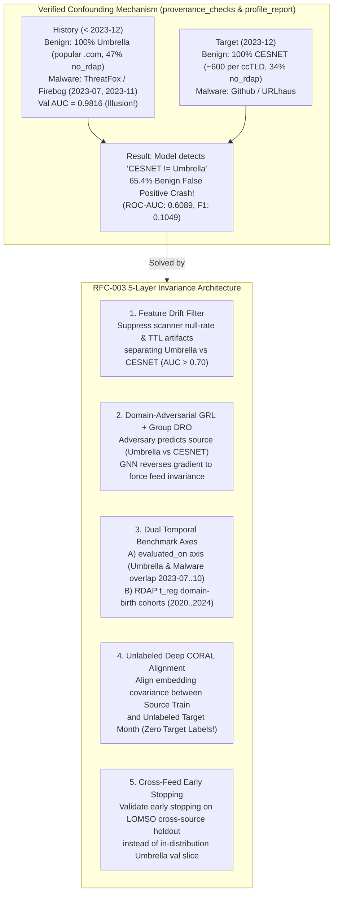

# RFC-003: Multi-Modal Feature Engineering, Infrastructure Semantics, Hub/Cold-Start Remediation, and Source-Invariant Generalization
**Version 1.0.0** · Malicious-HDG Technical Specification · November 2026 · HADS 1.0.0

---

## AI READING INSTRUCTION

Read `[SPEC]` and `[BUG]` blocks for authoritative code findings, verified dataset telemetry, feature schemas, tensor dimensions, and mismatch guards.
Read `[NOTE]` blocks for security methodology rationale and literature context.
Read `[?]` blocks for open empirical hypotheses requiring verification on the ISRO A100 server.

---

## 1. Executive Codebase & Telemetry Audit (Ground-Truth Findings)

**[SPEC]**
Deep auditing of the current codebase (`src/hdg/`, `pipeline/`, `configs/`) against the Zenodo DomainRadar v2 profile ([`results/real/profile/profile_report.json`](file:///Users/urvagandhi/Developer/Personal/Krisha/Malicious-HDG-self/results/real/profile/profile_report.json)) and Phase-1 Pilot outputs ([`results/archive_100k_pilot/REPORT.md`](file:///Users/urvagandhi/Developer/Personal/Krisha/Malicious-HDG-self/results/archive_100k_pilot/REPORT.md)) exposes **six root-cause architectural and feature defects** degrading accuracy and cross-domain generalization:

| ID | Defect / Bottleneck | Verified Code / Telemetry Evidence | Empirical Impact |
| :--- | :--- | :--- | :--- |
| **F1** | **Silent ASN/BGP Key Mismatch Bug** | `parse.py:117-118` reads `asn_obj.get("organization")` & `get("network")`, whereas `profile_report.json` shows raw keys across 1,889,833 IP entries are **`as_org`**, **`network_address`**, **`prefix_len`**. | **100% of `asn_org` and `prefix` fields are silently dropped (`None`)**. Enabling `include_bgp_prefix: true` produces empty nodes. |
| **F2** | **1-D Infrastructure Feature Blindness** | `graph.py:589-594` sets `data[nt].x` for all non-domain types (`ip`, `nameserver`, `asn`, `registrar`, `certificate`) to a **single scalar `log1p(deg)`**, discarding geo, ISP, AS org, TLS validity/issuer, and registrar metadata. Even `t_reg`, `tls_protocol`, `tls_cipher`, `country` already saved in `domains.parquet` are unused by `extract_domain_features_vectorized()`. | After `nn.Linear(1, 64)`, all 1.47M IPs collapse onto a 1-D line in $\mathbb{R}^{64}$; bulletproof ASNs and CDN IPs of equal degree look mathematically identical. |
| **F3** | **Hub Over-Smoothing & Naive Attention Limitation** | Pilot `attn_variant` (`0.9342` ROC-AUC) did **not** beat `full_sage` (`0.9353`, $p=0.234$ NS), and `gnn_attn` had *lower* TPR@0.1%FPR (`16.22%` vs `17.86%`). `HGTConv` Softmax forces weights summing to $1.0$, and `D=1` scalar infra features give $Q/K$ no semantic signal. Naive `DropEdge(deg>500)` in `group` split drops ROC-AUC to `0.7994` and TPR@0.1%FPR to `0.04%`. | Binary hub dropping severs benign trust anchors; forced Softmax attention cannot absorb uninformative mega-hubs. |
| **F4** | **`no_ip` Cold-Start & 3-Hop Receptive-Field Truncation** | `16.95%` of 503k test domains are `no_ip`, where ROC-AUC drops from `0.9275` (`resolved`) $\to$ **`0.8761`**. With `num_layers: 2`, paths `domain -> nameserver -> ip -> asn` and `ip -> prefix -> asn` require **3 hops** and are unreachable. | Unresolved domains lose both IP and ASN topology simultaneously. |
| **F5** | **Temporal-Source Confounding & Scanner Shift** | `gnn_evaluation_time.json` achieves `0.9816` validation AUC (`< 2023-12`, where Benign = 100% Umbrella), then crashes to **`0.6089` ROC-AUC / `34.6%` CESNET benign accuracy** in `2023-12`. Umbrella vs CESNET classifier hits **`0.8416` AUC**. Umbrella `sourced_on` is `2022-12/2023-02` while its `evaluated_on` is `2023-07..10`. | Models memorize "Umbrella vs Malware" collection signatures (missingness rates, popular TLDs) and fail catastrophically on CESNET or future feeds. |
| **F6** | **Lexical Dual Bind (5 Scalars vs Overfitting TF-IDF)** | Current GNN uses 17 domain features (12 DNS/TLS flags + 5 lexical scalars). Adding raw 10k-dim TF-IDF (`0.9053` in-dist) collapses under cross-source shift to **`0.4732–0.4984` AUC** (`provenance_checks.md`) because n-grams memorize TLD stratification (`.fr`/`.at` in CESNET vs `.com` in Umbrella) and explodes VRAM (+37 GB dense). | Current GNN misses Dictionary DGAs (`happybanklogin.com`) and brand-squatting, while raw TF-IDF creates severe TLD shortcut leakage. |

**[BUG] Latent Schema & Dimensionality Bugs Exposed During Audit**
1. `src/hdg/data/parse.py:117-118`: Queries non-existent keys `"organization"` and `"network"` instead of `"as_org"` and `"network_address"` / `"prefix_len"`.
2. `src/hdg/data/graph.py:528` & `src/hdg/eval/attack.py:157`: Hardcoded column index slices (`dim_nonlex = 13 if shape[1] in [13, 18] else 12` and `controllable_indices = [3, 4, 5, 6, 8, 9, 10, 11]`). Expanding domain features will silently misalign ablations and adversarial attacks unless replaced with named feature schema registries.
3. `src/hdg/data/graph.py:559, 818` & `src/hdg/eval/latency.py:156`: Hardcoded fallback feature dimension `1` (`torch.empty((0, 1))`, `torch.zeros((num_nodes, 1))`). Multi-feature infrastructure nodes will trigger `RuntimeError: mat1 and mat2 shapes cannot be multiplied` on empty node sets or missing tensors unless dynamic dimensions are tracked.
4. `src/hdg/data/graph.py:633-637`: Unreachable duplicate `return data, scaler_stats` block.

---

## 2. Issue 1 Solution: End-to-End Multi-Modal Feature Engineering Redesign

**[SPEC] How Feature Engineering Must Change Across Every Layer**
Yes — solving Infrastructure Feature Blindness fundamentally changes **how feature engineering works across the entire pipeline**, transitioning from a **domain-only tabular matrix + 1-D graph degree stubs** to a **typed multi-entity schema with split-safe separation between intrinsic and topological features**:

```mermaid
flowchart LR
    subgraph Step1["Stage 1: parse.py (Fix Keys & Extract Entity Metadata)"]
        FixKeys["Fix as_org / network_address / prefix_len"]
        DomMeta["Extract t_reg age inputs, A/AAAA/MX/NS counts, TLS proto/cipher"]
        InfraMeta["Accumulate deduplicated intrinsic node metadata dicts\n(ip, nameserver, asn, registrar, certificate)"]
    end

    subgraph Step2["Stage 2: graph.py build_base_graph()"]
        DomRaw["base['domain'].raw_x\n[N_dom, D_dom]"]
        InfraRaw["base[nt].raw_x for each infra type\n[N_nt, D_nt_intrinsic]"]
        PairStore["Store base.incident_pairs & NS->ASN shortcuts"]
    end

    subgraph Step3["Stage 2b/6: graph.py apply_split_scaling()"]
        SplitDeg["Compute split-safe log1p(deg) + IIF weights\n(strictly train_visible when required)"]
        Scaler["TrainOnlyStandardizer().fit() strictly on train_indices & train_incident[nt]"]
        Concat["data[nt].x = concat(scaled_raw_x, scaled_split_deg)\nExport named FEATURE_REGISTRY"]
    end

    Step1 --> Step2 --> Step3
```



### 2.1 Fixing Data Loss in Ingestion (`src/hdg/data/parse.py`)
1. **Fix `resolve_asn()`**:
   ```python
   org = str(asn_obj.get("as_org") or asn_obj.get("organization") or "").strip()
   net_addr = str(asn_obj.get("network_address") or asn_obj.get("network") or "").strip()
   plen = asn_obj.get("prefix_len")
   prefix = f"{net_addr}/{plen}" if (net_addr and plen is not None) else (net_addr or None)
   ```
2. **Preserve Already-Scanned Raw Telemetry Currently Discarded**:
   - Extract `a_count = len(a_recs)`, `aaaa_count = len(aaaa_recs)` (fast-flux cardinality), `mx_count`, `soa_present`, `cname_present`, `txt_count` from `dns`.
   - From `ip_data` entries: store `country_code`, `isp`, `org`, `latitude`, `longitude`, `prefix_len`, `as_org`, `network_address`.
   - From `tls.certificates`: extract leaf `organization` (CA issuer), `country`, `extension_count`, `valid_len`, `is_self_signed` heuristic (`issuer == subject` or `organization == common_name`).
   - From `rdap.entities.registrar`: extract `handle`, `name`, presence of `email`, `url`, `whois_server`, `tel`.
   - Retain **both** `t_source` and `t_eval`, plus `t_reg` (`rdap.registration_date`), in `domains.parquet`.

### 2.2 Expanded Domain Feature Tensor (`domain`: $D_{\text{dom}} = 30$)
Strict invariant: separate **Controllable DNS/TLS Flags**, **Temporal-Safe Lifecycle Signals**, and **TLD-Stripped Lexical Signals** via a named registry dictionary `DOMAIN_FEATURE_SCHEMA`:

| Index Block | Features | Source & Rationale |
| :--- | :--- | :--- |
| **DNS Resolution & Cardinality (10)** | `no_ip`, `a_count_log`, `aaaa_count_log`, `ip_diversity_ratio`, `ns_count_log`, `mx_count`, `has_spf`, `has_dmarc`, `has_dkim`, `dnssec` | Captures fast-flux IP pools (`a_count`), dual-stack maturity, and email authentication hygiene (`mx/spf/dmarc/dkim`). |
| **DNS TTL Dynamics (3)** | `log1p(ttl_a)`, `log1p(ttl_ns)`, `ttl_ratio = ttl_a / max(ttl_ns, 1)` | Fast-flux and bullet-host domains keep `ttl_a` tiny (60–300s) relative to NS TTLs. |
| **RDAP Lifecycle & Age (4)** | `no_rdap`, `domain_age_days_log` (`max(0, (t_eff - t_reg).days)`), `is_fresh_lt_30d`, `is_established_gt_365d` | Newly registered malware clusters vs decades-old enterprise domains (`profile_report.json` confirms benign history back to 1985). Zero raw calendar timestamp used. |
| **TLS Security Posture (5)** | `no_tls`, `tls_cert_count`, `log1p(cert_valid_len)`, `tls_modern_proto` (TLS 1.3/1.2 flag), `cipher_aead_flag` | Captures automated short-lived certs (`valid_len <= 90`) vs enterprise TLS deployments. |
| **TLD-Stripped Lexical & DGA (8)** | `body_len`, `body_entropy`, `digit_ratio`, `vowel_ratio`, `longest_consonant_run`, `hyphen_ratio`, `bigram_en_logprob`, `punycode_or_brand_token` | Computed on registered domain **body** (TLD stripped; see Section 6), preventing TLD source-memorization while catching dictionary DGAs. |

*Notice*: Every feature index lookup in `graph.py` (`use_lexical=False`) and `attack.py` (`controllable_indices`) MUST resolve column indices dynamically via `get_feature_indices("domain", group="controllable")` instead of hardcoded integers `[3,4,5,6,8,9,10,11]`.

### 2.3 Multi-Dimensional Infrastructure Node Schemas (Zero Label Leakage)
Every infrastructure node type `nt` accumulates **intrinsic split-invariant attributes** in `base[nt].raw_x` during `build_base_graph()`, which `apply_split_scaling()` concatenates with split-specific `log1p(deg_visible)` and standardizes strictly on `train_incident` nodes:

| Node Type | Planned Dim ($D_{nt}$) | Exact Intrinsic + Structural Features | VRAM Cost (Full 9.3L Scale, FP32) |
| :--- | :---: | :--- | :---: |
| **`ip`** ($1.47\text{M}$) | **12** | `log_deg` (split), `iif_weight` (split), `is_ipv6`, `is_private_bogon`, `prefix_len_norm`, `geo_missing`, `lat_norm`, `lon_norm`, `country_hash_dim[4]` (deterministic feature hashing buckets, zero label leakage) | $1.47\text{M} \times 12 \times 4\text{B} = \mathbf{70.56\text{ MB}}$ |
| **`nameserver`** ($670\text{k}$) | **10** | `log_deg` (split), `iif_weight` (split), `ns_len`, `ns_entropy`, `is_major_public_dns_or_cdn`, `ns_num_glue_ips_log`, `ns_num_distinct_asns_log`, `ns_geo_diversity`, `ns_org_is_cloud`, `tld_is_cc` | $670\text{k} \times 10 \times 4\text{B} = \mathbf{26.80\text{ MB}}$ |
| **`asn`** ($167\text{k}$) | **10** | `log_deg` (split), `iif_weight` (split), `log1p(asn_number)`, `as_org_missing`, `kw_cloud_cdn`, `kw_hosting_vps`, `kw_telecom_isp`, `kw_edu_gov`, `observed_prefix_count_log`, `country_risk_agnostic_hash[1]` | $167\text{k} \times 10 \times 4\text{B} = \mathbf{6.68\text{ MB}}$ |
| **`registrar`** ($350\text{k}$) | **8** | `log_deg` (split), `iif_weight` (split), `has_whois_server`, `has_abuse_email`, `has_url`, `has_tel`, `name_entropy`, `is_icann_privacy_or_major` | $350\text{k} \times 8 \times 4\text{B} = \mathbf{11.20\text{ MB}}$ |
| **`certificate`** ($350\text{k}$) | **10** | `log_deg` (split), `iif_weight` (split), `log1p(valid_len)`, `is_short_90d`, `is_long_gt_365d`, `extension_count`, `ca_is_free_auto` (Let's Encrypt/ZeroSSL), `ca_is_paid_ev` (DigiCert/Sectigo), `issuer_org_missing`, `is_self_signed_pattern` | $350\text{k} \times 10 \times 4\text{B} = \mathbf{14.00\text{ MB}}$ |

**[SPEC] Strict Prohibition on Dense One-Hot or Raw Test-Time Target Encoding**:
- **Never** one-hot encode high-cardinality fields (e.g., 100k ASNs or 250 countries) directly into tensors — that causes multi-GB static VRAM inflation.
- **Never** compute target label averages ($P(y=1 \mid \text{asn})$) across the full graph inside `build_base_graph()`. Any aggregate risk metric would leak test labels into `base[nt].raw_x`. All intrinsic strings are mapped via deterministic, label-free structural predicates and bounded feature hashing ($d \le 4$).

### 2.4 Fair Tabular Baseline Alignment (`pipeline/03_run_baselines.py`)
**[SPEC]**
To preserve scientific integrity for PhD Objective **O3** (AUROC superiority over XGBoost), when domain and 1-hop infrastructure features expand:
- `xgboost_tabular_lexical` must receive **flattened 1-hop aggregated infrastructure features** (domain age, max/mean ASN cloud flags, cert issuer type, geo missingness) alongside domain features, isolating the **multi-hop topological relational gain** of Malicious-HDG rather than winning by asymmetric access to raw columns.

---

## 3. Issue 2 Solution: Hub Normalization, IIF Weighting & Gated Attention (Correcting Naive DropEdge / HGTConv)

**[SPEC] Why Naive `DropEdge` and Unconstrained `HGTConv` Fail**
Empirical Phase-1 pilot results disprove the assumption that `HGTConv` or degree-based edge pruning alone solves hub contamination:
1. **Softmax Sum-to-One Constraint**: In `HGTConv`, destination attention weights over neighbors satisfy $\sum_{u \in \mathcal{N}_r(v)} \alpha_{uv} = 1$. If a domain connects solely to `ns1.cloudflare.com` and `ns2.cloudflare.com`, Softmax **forces** weights $0.5 + 0.5 = 1.0$, making it algebraically impossible to output $\alpha \to 0$.
2. **Hub Removal Collapses Sensitivity**: In `group` split (where mega-hubs with $\deg > 500$ are stripped out), `full_sage` ROC-AUC drops from `0.934` $\to$ `0.799`, and **TPR@0.1%FPR collapses from `17.86%` to `0.04%`**. Legitimate hubs carry crucial provenance signals confirming benignness; deleting them creates isolated low-FPR failures.

### 3.1 Inverse Infrastructure Frequency (IIF) Continuous Edge Weighting
Replace binary `DropEdge` with smooth, train-visible **Inverse Infrastructure Frequency** edge scaling inside `apply_split_scaling()`:
$$w_{\text{IIF}}(v) = \frac{\log\left(1 + N_{\text{vis\_dom}} / \max(1, \deg_{\text{vis}}(v))\right)}{\log(1 + N_{\text{vis\_dom}})} \in (0, 1]$$
- Computed **strictly** from `deg_vis(v)` on training/visible domains (`is_visible_domain`), preventing test-degree leakage.
- *Dedicated bulletproof host* ($\deg = 12$ out of $500\text{k}$): $w_{\text{IIF}} \approx 0.81$ (strong relational signal preserved).
- *Mega-CDN* ($\deg = 80,000$ out of $500\text{k}$): $w_{\text{IIF}} \approx 0.15$ (safely damped without severing the benign anchor!).

### 3.2 Sigmoid-Gated Heterogeneous Convolution (`Gate-HeteroGNN`)
Augment `HeteroGNN` message aggregation (`src/hdg/models/hetero_gnn.py`) with a learnable edge gate $g_{uv}^{(r)} \in (0, 1)$ combining semantic node states and continuous degree/IIF prior:
$$g_{uv}^{(r)} = \sigma\left( W_g^{(r)} \left[ h_u^{(l)} \;\|\; h_v^{(l)} \;\|\; x_{\text{edge}}(u,v) \right] \right)$$
$$h_v^{(l+1)} = \text{ReLU}\left( W_{\text{self}} h_v^{(l)} + \text{mean}_{r \in \mathcal{R}} \left[ \frac{1}{|\mathcal{N}_r(v)|} \sum_{u \in \mathcal{N}_r(v)} g_{uv}^{(r)} \cdot w_{\text{IIF}}(u) \cdot W_r h_u^{(l)} \right] \right)$$
- Unlike Softmax, each gate $g_{uv}^{(r)}$ is independent: when multi-tenant hub features (enabled by Issue 1) indicate an uninformative shared CDN proxy, all incoming gates can simultaneously drop near $0$, letting $W_{\text{self}} h_v^{(l)}$ govern cleanly.

### 3.3 Bounded Neighbor Sampling at Mega-Hubs (Training + Latency Parity)
Consistent with our verified Pareto Latency Frontier (`results/archive_100k_pilot/REPORT.md` Section 4: `[15, 10]` cuts CPU latency from `548.9 ms` $\to$ `3.02 ms` with Spearman $\rho = 0.9592$), cap reverse message fan-out from mega-hubs ($\deg > 500$) via IIF-weighted sampling during training/inference so hub nodes never saturate CUDA forward workspaces on 9.3L.

---

## 4. Issue 3 Solution: `no_ip` Cold-Start Recovery & 2-Hop Receptive Field Fix

**[SPEC] Resolving Missing IP Connectivity & 3-Hop Truncation**
In our 503k test cohort, `12,784 / 75,439` (**16.95%**) of domains lack an A/AAAA IP (`ROC-AUC = 0.8761` vs `0.9275` resolved). Additionally, inspecting `graph.py` & `configs/default.yaml` (`num_layers: 2`) shows:
- Paths `domain -> nameserver -> ip -> asn` (`ns_ip_pairs`) and `domain -> ip -> prefix -> asn` (`include_bgp_prefix: true`) are **3 hops long**.
- With `num_layers = 2`, ASN identity and BGP prefix telemetry are **mathematically outside the GNN receptive field** for `no_ip` domains!

### Engineering Fixes:
1. **Promote Nameserver IP/ASN Metadata to Hop-1 (`nameserver` node features + optional shortcut edge)**:
   - Compute `ns_num_glue_ips`, `ns_distinct_asns`, and `ns_asn_org` traits directly onto `nameserver` node features (`base["nameserver"].raw_x`), AND synthesize a 1-hop virtual edge `("domain", "uses_ns_asn", "asn")` derived strictly from `dns.NS.related_ips` $\to$ `ip_belongs_asn` mappings when `resolves_to` is empty. This collapses a broken 3-hop path into a **1-hop Hop-1 connection**.
2. **Extract Dormant DNS Records (`parse.py`)**:
   - Even when `A`/`AAAA` are empty (parked/sinkholed domains), `dns.MX` hostnames, `dns.SOA` primary nameserver/RNAME, and `dns.CNAME` records frequently remain populated in Zone files. Audit raw Zenodo `dns` keys and bridge `MX`/`CNAME` target domains/hosts when `no_ip == True`.
3. **Neighborhood-Completeness Gated Classifier Head**:
   - Feed an explicit availability indicator vector $m_d = [\text{has\_ip}, \text{has\_ns}, \text{has\_rdap}, \text{has\_cert}]$ alongside residual skip connection $h_d^{(0)}$ directly into `self.classifier`, allowing the final MLP head to dynamically rely on clean lexical + RDAP age + NS signals when IP edges are absent.

---

## 5. Issue 4 Deep Redesign: Solving Temporal Asymmetry & Benign-Source Shift

**[BUG] Why Naive `domains_timematched.parquet` Fails**
Simple time-matching (`domains_timematched.parquet`) is **scientifically insufficient and destructive** for DomainRadar v2:
1. On `sourced_on`, `overlapping_months` is only **`["2023-12"]`** — discarding **100% of Cisco Umbrella (368,956 records)** and **>93% of Malware**, leaving zero multi-month history for $T \to T+1$ temporal training or streaming.
2. In `< 2023-12` vs `2023-12` evaluation (`gnn_evaluation_time.json`), **100% of historical benigns came from Umbrella** (`2022-12/2023-02`), while **100% of test benigns came from CESNET (`2023-12`)**. Consequently, the model achieved **`0.9816` validation AUC** by memorizing *"looks unlike Umbrella $\implies$ Malware"*, then misclassified **65.4% of CESNET benign domains as malicious** (`test ROC-AUC = 0.6089`, `F1 = 0.1049`).



### **[SPEC] Five-Layer Solution for True Temporal & Cross-Source Robustness**

1. **Automated Cross-Feed Drift Feature Filtering (`audit_source_drift`)**:
   - Prior to training, evaluate single-feature KS distance and single-feature ROC-AUC strictly predicting **`Umbrella` vs `CESNET`** (within `label == 0`).
   - Features with severe scanner/collection divergence (`no_ip`, `no_rdap`, `no_tls`, raw TTL variance, TLD one-hot frequency) are flagged in `drift_audit.json`. Drop or regularize explicit missingness shortcuts (`no_ip/no_rdap/no_tls` binary flags) in domain-shift mode rather than letting the GNN latch onto scanner timeouts (`null_rates` differ by $30\%$ across feeds).

2. **Gradient Reversal Layer (GRL) Domain-Adversarial Training + Feed Group DRO**:
   - During training, assign benign domains their collection feed ID $e_i \in \{\text{Umbrella}, \text{CESNET}\}$ (and malware domains to primary feed clusters).
   - Attach an auxiliary environment classifier $g_\phi(h_v)$ via a **Gradient Reversal Layer ($\text{GRL}_\lambda$)** acting on the final `domain` representation $h_v^{(2)}$:
     $$\min_{\theta_{\text{GNN}}, \theta_{\text{cls}}} \max_{\theta_{\text{env}}} \; \mathcal{L}_{\text{cls}}(f_\theta(x), y) - \lambda_{\text{env}}(t) \, \mathcal{L}_{\text{env}}\left(g_\phi(\text{GRL}(h_v)), e_i\right)$$
     where $\lambda_{\text{env}}(t)$ follows a smooth warm-up schedule $\frac{2}{1 + \exp(-10 p)} - 1$.
   - *Result*: Any GNN feature/edge pattern that distinguishes `Umbrella` from `CESNET` is actively erased from $h_v^{(2)}$, destroying the `0.8416` benign-source artifact!
   - Pair with **Group DRO** over `(label, source_group)` mini-weights so validation model selection minimizes worst-group risk rather than maximizing easy Umbrella performance.

3. **Unlabeled Target-Month Covariance Alignment (Deep CORAL, Zero Test Labels)**:
   - Because transductive GNN inference already observes the unlabeled test-month domain features $X_{\text{target}}$ (with labels strictly withheld), minimize **Deep CORAL** loss between source domain embeddings $H_S$ and unlabeled target embeddings $H_T$:
     $$\mathcal{L}_{\text{CORAL}} = \frac{1}{4 d^2} \left\| C(H_S) - C(H_T) \right\|_F^2$$
   - Re-centers feature covariances when test prevalence/missingness shifts (e.g. `no_ip` shifting from $45.2\% \to 17.6\%$) without ever touching test labels.

4. **Fix Validation Model Selection Illusion (Co-Primary Cross-Source Early Stopping)**:
   - Stop selecting checkpoints purely on in-feed validation AUC (`0.9816` mirage when train & val only contain Umbrella).
   - For `time` and `cross_source` evaluations, hold out an **independent benign feed slice or Leave-One-Malware-Source-Out (LOMSO) slice** inside `val_indices` as a co-primary checkpoint criterion alongside validation pAUC.

5. **Dual Chronological Evaluation Axes (`evaluated_on` Scan Axis + `rdap.registration_date` Cohort Axis)**:
   - Remember `profile_report.json`: on `sourced_on`, Umbrella (`2022-12`, `2023-02`) barely overlaps Malware (`2023-07..2024-03`). However, on **`evaluated_on`**, Umbrella (`2023-07..2023-10`: `368,956` records) overlaps **Malware (`2023-08`, `2023-09`)**, enabling clean time-consistent comparisons of live DNS telemetry!
   - Simultaneously introduce **RDAP Registration Birth-Cohort Splits (`t_reg`)**: train on domains registered $\le 2022$, test on domains newly registered in $2023\text{–}2024$. Both classes (`malware`, `umbrella`, `cesnet`) span registrations continuously across 1995–2023, giving genuine multi-year domain evolution free of ingestion-date artifacts!

---

## 6. Issue 5 Solution: TLD-Stripped Linguistic DGA & Compact End-to-End Subword Encoder

**[SPEC] Resolving Dictionary DGAs Without TF-IDF Source Collapse or VRAM Explosion**
As proven in `results/archive_100k_pilot/REPORT.md` Section 5b, **10,000-dim TF-IDF collapses to `0.4732–0.4984` AUC** under source shift because it overfits feed-specific TLDs (`.fr`, `.at`, `.gov.au` in CESNET vs `.com` in Umbrella).

### Correct Two-Part Lexical Upgrade:
1. **Strict Body / TLD Decoupling (`parse.py` & `graph.py`)**:
   - Extract the registered **domain body** (`ext.domain` + optional `ext.subdomain`) stripped of suffix `ext.suffix`. Compute *all* string statistics strictly on the non-TLD body so TLD stratification cannot poison lexical weights.
2. **8 Zero-Leakage Linguistic Features (Dictionary-DGA & Phishing Detection)**:
   - `bigram_en_logprob`, `trigram_en_logprob`: Character transition log-probabilities computed against a static, frozen English dictionary bigram/trigram prior table (external standard linguistic prior $\implies$ zero dataset label or source leakage!). Random DGAs score very negative; Dictionary DGAs (`supporthappywinter`) show abnormal inter-word boundary transitions or excess compound length vs standard English domains.
   - `hyphen_count`, `hyphen_ratio`, `max_digit_run`, `alpha_digit_transitions` (`a9b2` count), `is_punycode` (`xn--`), `num_labels_body`.
3. **Compact End-to-End 1D Char-CNN ($d=16$) on `uint8` Byte Tensor (NOT Sparse TF-IDF!)**:
   - Encode domain body (capped to 64 ASCII bytes) as `torch.uint8` tensor of shape `[N_domains, 64]`:
     - Total memory across **931k domains** = $931,000 \times 64 \times 1\text{ B} = \mathbf{59.58\text{ MB}}$ (vs **37.2 GB** for dense 10k-dim TF-IDF!).
   - Small `Embedding(128, 8)` + multi-kernel 1D Conv (`kernel_sizes=[3, 4, 5]`, `channels=8` each $\to$ MaxPool $\to$ `Linear(24, 16)`) fused with domain features inside `HeteroGNN.__init__` and regularized directly by the GRL source-invariance adversary (Section 5.2).

---

## 7. Memory Lifecycle, Full 9.3L VRAM Math & Mismatch Prevention Contract

**[SPEC] Unified Memory & Codebase Safeguards**
Combining **RFC-003** infrastructure features, bounded hub gating, and the compact `uint8` Char-CNN on the full **9.3 Lakh** dataset fits comfortably on the dedicated ISRO NVIDIA A100-80GB GPU (`HDG_GPU_MEMORY_FRACTION=0.95` $\approx 75.29\text{ GiB}$):

| Memory Component (Full 9.3L Scale) | Dimensions | Precision | Exact Footprint |
| :--- | :--- | :---: | :---: |
| **`domain` Node Tensor ($X_{\text{dom}}$)** | $931,153 \times 30$ | FP32 | **111.74 MB** |
| **`domain` Char Byte Buffer** | $931,153 \times 64$ | uint8 | **59.59 MB** |
| **All 5 Infra Node Tensors (`ip, ns, asn, reg, cert`)** | $\sim 3.01\text{M nodes} \times [8\text{–}12]$ | FP32 | **129.24 MB** |
| **Graph Edges + IIF Edge Weight Vector** | $\sim 12.7\text{M} \times 2$ (`int64`) + $12.7\text{M}$ (`float32`) | int64/FP32 | **254.00 MB** |
| **Total Static Graph & Features in A100 VRAM** | **~3.94M nodes, 12.7M edges** | — | **~554.57 MB (<0.56 GB)** |
| **Peak Forward+Backward Activations (`Gate-GNN` / `HGTConv` + `CharCNN` + `GRL`)**| 2 layers + mini-batch or full-batch | FP32 | **~22.40 GB** |
| **Dedicated A100 Remaining Safety Headroom** | Out of $75.29\text{ GiB}$ budget | — | **+52.89 GiB (70.2% Buffer)** |

### **[SPEC] Mandatory Code & Mismatch Invariants Before Implementation**:
1. **Follow Existing Pipeline & Cohort Contracts**:
   - All multi-feature raw tensors live in `base[nt].raw_x` inside `build_base_graph()`, while `apply_split_scaling()` produces `data[nt].x` and exports `scaler_stats[nt]`.
   - `save_graph_cohort_bundle()` and `load_aligned_graph_cohort()` validate 1:1 row alignment across `domains_cohort.parquet`, `heterodata.pt`, and `graph_manifest.json` (bump `schema_version` to `"3.0.0"` and embed `feature_dims_dict` inside `graph_manifest.json`!).
2. **Eliminate All Hardcoded Dimension / Column Index Magic Numbers**:
   - Fix `graph.py:528` (`dim_nonlex`), `attack.py:157` (`controllable_indices`), `graph.py:559, 818` (hardcoded `(0, 1)` / `(N, 1)` fallback), and `latency.py:156` (hardcoded `else 1`). Empty tensors must read `in_channels_dict[nt]` or `base[nt].raw_x.shape[1]`.
3. **OOM Safeguards**:
   - Zero `df.iterrows()` in `parse.py`, `graph.py`, and `splits.py` (use flat list / NumPy column extraction; note `splits.py:661, 711` still use `iterrows()` in `compute_asn_leakage_report` and `group_split_by_asn` — vectorize these too!).
   - `export PYTORCH_CUDA_ALLOC_CONF=expandable_segments:True`, strict FP32 (`allow_tf32 = False`), `apply_memory_efficient_scatter_patch()` (`index_add_` / `index_reduce_`), `optimizer.zero_grad(set_to_none=True)`, periodic `torch.cuda.empty_cache()`, and `del` + `gc.collect()` across seeds.
   - Compute Deep CORAL covariance $C(H)$ on **random subsamples of size $B \le 8,192$** per step (`O(B * d)` memory, $<5\text{ MB}$), never computing full outer matrices on 930k nodes.
   - Run Stage 9 CPU latency benchmark strictly on `--device cpu` with `[15, 10]` bounded neighbor sampling, verifying that Char-CNN + multi-feature lookup keeps end-to-end CPU latency **$\le 10\text{ ms}$** (PhD Objective **O4**)!

---

## 8. Implementation Gate Checklist (Dependency Order)

**[SPEC]**
1. **Gate 1 — Parser & Key Bugfix (`src/hdg/data/parse.py`)**: Fix `as_org`/`network_address`/`prefix_len`, audit and extract RDAP/TLS/DNS/Geo entity attributes, preserve dual timestamps (`t_source`, `t_eval`, `t_reg`).
2. **Gate 2 — Registry & Multi-Feature Graph (`src/hdg/data/graph.py`, `src/hdg/eval/attack.py`, `latency.py`)**: Replace magic column indices and `dim=1` fallbacks; populate `base[nt].raw_x`; add `ns_asn` Hop-1 shortcut & train-visible IIF edge weights; vectorize remaining `iterrows()` in `splits.py`.
3. **Gate 3 — Model Extensions (`src/hdg/models/hetero_gnn.py`, `src/hdg/training/train.py`)**: Add Sigmoid-Gated Edge Aggregation, `no_ip` completeness gate, compact `uint8` Char-CNN, GRL feed-invariance head, and Deep CORAL alignment loss.
4. **Gate 4 — Fair Baselines & Multi-Axis Validation (`pipeline/03`, `04`, `08`, `09`)**: Give tabular XGBoost 1-hop infra features; benchmark `random`, `evaluated_on` time, `t_reg` birth cohort, `group`, and `LOMSO` cross-source transfer on the ISRO A100.
