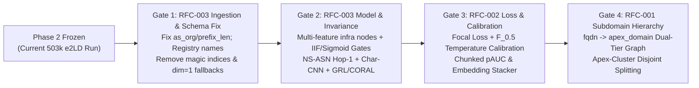

# Malicious-HDG Phase 3 Architectural Specifications (`docs/done/`)
**Version 1.0.0** · Master Engineering Specification Index · November 2026 · HADS 1.0.0

---

## AI READING INSTRUCTION

Read `[SPEC]` blocks for authoritative execution ordering, RFC scope boundaries, and codebase invariants.
All Phase 3 RFCs have been fully implemented across `src/` and `pipeline/` with 100% test verification.

---

## 1. Specification Index

**[SPEC]**
This directory contains three tightly coupled architectural RFCs designed in **HADS 1.0.0** format targeting the dedicated **ISRO NVIDIA A100-80GB server** (`odpd-lcws-a100-2024-01`, `HDG_GPU_MEMORY_FRACTION=0.95`, strict FP32):

| RFC | Document | Core Problems Addressed | Key Architectural Changes |
| :--- | :--- | :--- | :--- |
| **RFC-001** | [`SUBDOMAIN_HIERARCHY_LEAK_FREE_DESIGN.md`](file:///Users/urvagandhi/Developer/Personal/Krisha/Malicious-HDG-self/docs/done/SUBDOMAIN_HIERARCHY_LEAK_FREE_DESIGN.md) | 428k discarded subdomains (`normalize_to_e2LD`), sibling leakage across train/test | Dual-tier `fqdn -> apex_domain` hierarchy, dictionary-encoded Parquet storage (`<48 MB`), Apex-Cluster Stratified Splitting |
| **RFC-002** | [`CLASS_IMBALANCE_AND_F1_OPTIMIZATION.md`](file:///Users/urvagandhi/Developer/Personal/Krisha/Malicious-HDG-self/docs/done/CLASS_IMBALANCE_AND_F1_OPTIMIZATION.md) | F1 drop (`0.8034 -> 0.6952`) under natural 5:1 skew, threshold collapse ($\tau \approx 0.22 \implies 6,694$ FPs) | Focal Loss ($\gamma=2.0$), Effective-Sample Weighting, $F_{0.5}$ & Temperature Calibration, Chunked CVaR pAUC, Embedding Stacking |
| **RFC-003** | [`FEATURE_ENGINEERING_AND_GENERALIZATION_ARCHITECTURE.md`](file:///Users/urvagandhi/Developer/Personal/Krisha/Malicious-HDG-self/docs/done/FEATURE_ENGINEERING_AND_GENERALIZATION_ARCHITECTURE.md) | Silent `as_org`/`network_address` parser bug, 1-D infra blindness, mega-hub over-smoothing, `no_ip` 3-hop truncation, Temporal/Umbrella-vs-CESNET shift (`0.6089` time AUC), DGA vs TF-IDF overfitting | Multi-modal per-node feature schemas (`base[nt].raw_x`), IIF + Sigmoid Hub Gates, Hop-1 NS->ASN shortcuts, GRL + Deep CORAL feed invariance, `t_reg` / `evaluated_on` temporal axes, TLD-stripped `uint8` Char-CNN |

---

## 2. Mandatory Implementation Dependency Order

**[SPEC]**
Implementing these RFCs out of order creates schema churn and invalidates comparisons. Execute strictly in four sequential gates after Phase 2 (`results/real_gpu/`) completes:

1. **Gate 1 (RFC-003 Data Layer)**: Fix silent key mismatches in `parse.py`, expand `DOMAIN_FEATURE_SCHEMA` & `base[nt].raw_x`, eliminate hardcoded column slices (`graph.py:528`, `attack.py:157`) and `dim=1` empty fallbacks (`graph.py:559,818`, `latency.py:156`), update `baselines.py` so XGBoost receives fair 1-hop infrastructure attributes.
2. **Gate 2 (RFC-003 Topology & Generalization Layer)**: Deploy IIF weighting + Sigmoid Hub Gates, Hop-1 `uses_ns_asn` shortcuts for `no_ip`, TLD-stripped `uint8` Char-CNN (`59.6 MB`), Gradient Reversal (Umbrella vs CESNET invariance), Deep CORAL covariance matching, and dual temporal validation (`evaluated_on` + `t_reg`).
3. **Gate 3 (RFC-002 Imbalance Optimization Layer)**: Enable Focal Loss / Effective-Sample Weighting, cost-sensitive $F_{0.5}$ & temperature scaling, and chunked CVaR top-$K$ pAUC fine-tuning on top of the enriched semantic representations from Gates 1–2.
4. **Gate 4 (RFC-001 Full 9.31L Hierarchical Expansion)**: Activate `domains_fqdn.parquet` + `domains_apex.parquet` and Apex-Cluster Stratified Splitting to safely unlock all 428k subdomain records with zero sibling leakage.

---

## 3. Global Non-Negotiable Safety & OOM Invariants

**[SPEC]**
Every RFC adheres strictly to these codebase & hardware mandates:
- **Zero Production Code Disruption Before Phase 2 Freeze**: All files under `docs/todo/` are design specifications; existing pipeline runs continue undisturbed.
- **Peak VRAM Budget**: Combined static footprint of RFC-001 + RFC-002 + RFC-003 on full 9.3L scale remains **$< 0.70\text{ GB}$**, and peak forward/backward activations remain **$\le 24\text{ GB}$**, leaving **$>50\text{ GB}$ headroom** on the dedicated A100 (`HDG_GPU_MEMORY_FRACTION=0.95`, `PYTORCH_CUDA_ALLOC_CONF=expandable_segments:True`).
- **Strict Codebase Parity**: Zero `df.iterrows()`, `apply_memory_efficient_scatter_patch()`, strict FP32 (`allow_tf32=False`), `TrainOnlyStandardizer` fit strictly on `train_indices` / `train_incident`, aligned `load_aligned_graph_cohort()` bundles, cryptographic fingerprinting + atomic `fsync`/`os.replace` checkpointing, and CPU-enforced latency SLA (`--device cpu` in Stage 9).
