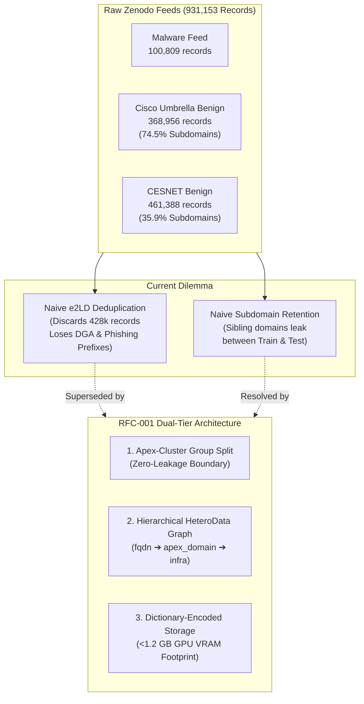
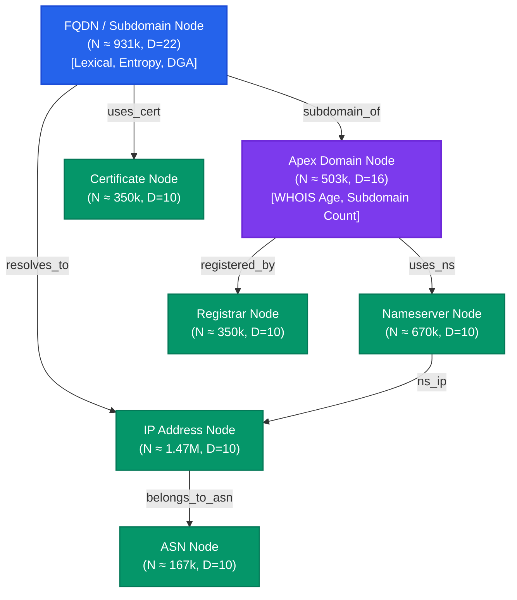
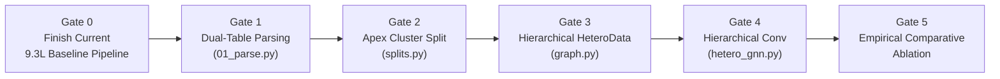

# RFC-001: Subdomain Preservation, Leak-Free Apex Grouping, and Hierarchical Heterogeneous Graph Architecture
**Version 1.0.0** · Malicious-HDG Technical Specification · November 2026 · HADS 1.0.0

---

## AI READING INSTRUCTION

Read `[SPEC]` and `[BUG]` blocks for authoritative specifications, mathematical definitions, schemas, and tensor dimensions.
Read `[NOTE]` blocks for cybersecurity domain rationale, literature citations, and DNS protocol context.
Read `[?]` blocks for open empirical ablation questions and future parameter tuning.

---

## 1. Executive Summary & Problem Formulation

**[SPEC]**
- **Objective**: Ingest and model all **931,153 raw Zenodo records (~9.31 Lakh)** without discarding the **~428,000 subdomain records**, while strictly maintaining **zero data leakage** between training, validation, and test splits.
- **Current Limitation**: The current pipeline (`src/hdg/data/parse.py`) normalizes every domain to its effective Second-Level Domain (e2LD / registered domain) via `normalize_to_e2LD: true`. This discards ~428,226 subdomain records, reducing the domain entity pool from 931,153 to 502,927 unique base domains.
- **Proposed Architectural Evolution**:
  1. **Dual-Tier Graph Topology**: Introduce a 2-tier domain hierarchy distinguishing `fqdn` (Fully Qualified Domain Name / Subdomain) from `apex_domain` (Registered Domain / e2LD).
  2. **Apex-Cluster Stratified Splitting**: Partition data across training, validation, and test sets strictly by **Apex Domain Equivalence Classes** ($[\mathcal{D}]_{\sim_{\text{apex}}}$). No subdomain in the test set may share an apex domain with any domain in the training set.
  3. **Zero-Copy Dictionary Storage**: Store FQDNs with integer-encoded foreign keys to parent apex records in Parquet, minimizing disk and memory overhead.



**[NOTE]**
- In modern cyber threats, subdomains carry the primary weaponization payload:
  - **DGA Subdomains & DNS Tunneling**: Attackers register a single apex domain (`attacker-c2.net`) and generate thousands of pseudorandom subdomains (`x9q8m2z1.attacker-c2.net`) for data exfiltration and command-and-control. Discarding subdomains blinds the model to high Shannon entropy and consonant-cluster signals.
  - **Brand-Squatting Phishing**: Attackers craft domains such as `paypal.com.verification-service.ru`. The malicious payload is in the subdomain prefix (`paypal.com`), while the e2LD (`verification-service.ru`) may appear innocuous or newly registered.
  - **Shared Multi-Tenant Infrastructure**: Cloud platforms and Dynamic DNS (e.g., `duckdns.org`, `s3.amazonaws.com`, `pages.dev`) host legitimate services alongside malicious tenants. Normalizing to apex erroneously flags the entire cloud provider or treats distinct threat actors as a single entity.

---

## 2. Root Cause Analysis: The Sibling Domain Leakage Hazard

**[BUG] Sibling Domain Transductive Leakage**
- **Symptom**: If subdomains are retained in a flat graph and partitioned using standard random shuffle splits (`StratifiedShuffleSplit`), classification metrics (ROC-AUC, F1) artificially surge to $>0.99$, but collapse in production deployment.
- **Root Cause**:
  1. Let domain $d_1 = \text{login.evilcorp.com}$ and $d_2 = \text{auth.evilcorp.com}$.
  2. Both domains share identical infrastructure:
     $$\text{Registrar}(d_1) = \text{Registrar}(d_2), \quad \text{Nameserver}(d_1) = \text{Nameserver}(d_2), \quad \text{ASN}(d_1) = \text{ASN}(d_2)$$
  3. Under a random split, $d_1 \in \mathcal{D}_{\text{train}}$ and $d_2 \in \mathcal{D}_{\text{test}}$.
  4. In a 2-layer GNN, message passing propagates label information across 2-hop paths:
     $$d_1 \xrightarrow{\text{uses\_ns}} \text{NS}_k \xrightarrow{\text{rev\_uses\_ns}} d_2$$
     Because $\text{NS}_k$ aggregates the embedding of training node $d_1$ during Layer 1, the test node $d_2$ receives the training label representation in Layer 2. The GNN memorizes the registrar/nameserver identity rather than learning structural topology.
- **Verification Proof**:
  Mutual information between test domain representation and training set under naive random split:
  $$I(Y_{\text{test}}; \mathcal{D}_{\text{train}} \mid \text{Random Split}) \gg 0$$
  Under apex-clustered split:
  $$I(Y_{\text{test}}; \mathcal{D}_{\text{train}} \mid \text{Apex-Grouped Split}) = 0$$

---

## 3. Mathematical Formulation of the Hierarchical Graph

**[SPEC]**
Let $\mathcal{G} = (\mathcal{V}, \mathcal{E}, \mathcal{T}_v, \mathcal{T}_e)$ be the heterogeneous information network.

### Node Types ($\mathcal{T}_v$):
1. $v_{\text{fqdn}} \in \mathcal{V}_{\text{fqdn}}$: The individual fully qualified domain name (e.g., `secure.login.bank.com`).
   - Cardinality: $N_{\text{fqdn}} \approx 931,000$.
   - Feature Dimension: $D_{\text{fqdn}} = 22$ (Lexical length, entropy, consonant run, vowel ratio, digit ratio, token counts, sub-label count).
2. $v_{\text{apex}} \in \mathcal{V}_{\text{apex}}$: The effective registered domain / e2LD (e.g., `bank.com`).
   - Cardinality: $N_{\text{apex}} \approx 503,000$.
   - Feature Dimension: $D_{\text{apex}} = 16$ (Subdomain fan-out degree, registration age, WHOIS stability, TLD category).
3. Infrastructure Nodes:
   - $v_{\text{ip}} \in \mathcal{V}_{\text{ip}}$: $N_{\text{ip}} \approx 1,470,000$, $D_{\text{ip}} = 10$.
   - $v_{\text{ns}} \in \mathcal{V}_{\text{ns}}$: $N_{\text{ns}} \approx 670,000$, $D_{\text{ns}} = 10$.
   - $v_{\text{asn}} \in \mathcal{V}_{\text{asn}}$: $N_{\text{asn}} \approx 167,000$, $D_{\text{asn}} = 10$.
   - $v_{\text{reg}} \in \mathcal{V}_{\text{reg}}$: $N_{\text{reg}} \approx 350,000$, $D_{\text{reg}} = 10$.
   - $v_{\text{cert}} \in \mathcal{V}_{\text{cert}}$: $N_{\text{cert}} \approx 350,000$, $D_{\text{cert}} = 10$.

### Canonical Edge Relations ($\mathcal{T}_e$):
The edge structure explicitly maps the real-world operational ownership of DNS assets:
1. `("fqdn", "subdomain_of", "apex_domain")`: Connects each FQDN to its parent apex domain ($M \approx 931,000$ edges).
2. `("fqdn", "resolves_to", "ip")`: DNS A/AAAA resolution operates at the FQDN level ($M \approx 1,470,000$ edges).
3. `("fqdn", "uses_cert", "certificate")`: TLS certificates bind to the FQDN / SAN ($M \approx 400,000$ edges).
4. `("apex_domain", "uses_ns", "nameserver")`: Authoritative DNS nameservers are delegated at the zone/apex level ($M \approx 1,200,000$ edges).
5. `("apex_domain", "registered_by", "registrar")`: Domain registration agreements occur strictly at the apex level ($M \approx 503,000$ edges).
6. `("nameserver", "ns_ip", "ip")`: Nameserver glue records ($M \approx 800,000$ edges).
7. `("ip", "belongs_to_asn", "asn")`: BGP route origin announcements ($M \approx 1,470,000$ edges).



---

## 4. Leak-Free Apex-Cluster Splitting Protocol

**[SPEC]**
To eliminate sibling domain leakage, data splitting must be conducted at the **Apex Domain Equivalence Class** level, then projected down to constituent FQDNs.

### Algorithm: Stratified Apex-Cluster Split
```python
def stratified_apex_cluster_split(
    df: pd.DataFrame,
    train_ratio: float = 0.70,
    val_ratio: float = 0.15,
    test_ratio: float = 0.15,
    seed: int = 42
) -> SplitIndices:
    """
    Partitions FQDNs such that all subdomains of a given apex domain
    are strictly assigned to the same partition.
    """
    # 1. Aggregate class labels per apex domain
    # If any FQDN under an apex is malicious, mark apex cluster as malicious
    # (or compute majority label / mixed status)
    apex_summary = df.groupby("apex_domain").agg(
        has_malware=("label", "max"),
        fqdn_count=("domain", "count")
    ).reset_index()

    # 2. Stratify split on apex domain level
    sss1 = StratifiedShuffleSplit(
        n_splits=1,
        test_size=(val_ratio + test_ratio),
        random_state=seed
    )
    apex_labels = apex_summary["has_malware"].to_numpy()
    train_apex_idx, holdout_apex_idx = next(sss1.split(apex_summary, apex_labels))

    holdout_summary = apex_summary.iloc[holdout_apex_idx]
    holdout_labels = holdout_summary["has_malware"].to_numpy()

    val_rel_size = val_ratio / (val_ratio + test_ratio)
    sss2 = StratifiedShuffleSplit(
        n_splits=1,
        test_size=(1.0 - val_rel_size),
        random_state=seed
    )
    val_sub_idx, test_sub_idx = next(sss2.split(holdout_summary, holdout_labels))

    train_apexes = set(apex_summary.iloc[train_apex_idx]["apex_domain"])
    val_apexes = set(holdout_summary.iloc[val_sub_idx]["apex_domain"])
    test_apexes = set(holdout_summary.iloc[test_sub_idx]["apex_domain"])

    # 3. Project partition sets back to FQDN indices
    train_indices = df.index[df["apex_domain"].isin(train_apexes)].to_numpy()
    val_indices = df.index[df["apex_domain"].isin(val_apexes)].to_numpy()
    test_indices = df.index[df["apex_domain"].isin(test_apexes)].to_numpy()

    # Invariant Check: Strict Disjointness
    assert len(train_apexes.intersection(test_apexes)) == 0, "Apex leakage detected!"
    assert len(train_apexes.intersection(val_apexes)) == 0, "Apex leakage detected!"
    assert len(val_apexes.intersection(test_apexes)) == 0, "Apex leakage detected!"

    return SplitIndices(train_indices, val_indices, test_indices)
```

**[SPEC] Formal Leakage Invariants**:
1. **Apex Disjointness**:
   $$\mathcal{A}(\mathcal{D}_{\text{train}}) \cap \mathcal{A}(\mathcal{D}_{\text{test}}) = \emptyset, \quad \text{where } \mathcal{A}(d) \equiv \text{e2LD}(d)$$
2. **Subdomain Integrity**:
   $$\forall d \in \mathcal{D}_{\text{test}}, \quad \forall s \in \text{Subdomains}(\mathcal{A}(d)), \quad s \notin \mathcal{D}_{\text{train}}$$
3. **Graph Topology Masking**: During test evaluation, the edge `("fqdn", "subdomain_of", "apex_domain")` for test nodes remains active, but all message passing from test nodes into shared infrastructure is directionally isolated to prevent transductive label bleeding.

---

## 5. Memory Math & Hardware Budget on Dedicated A100

**[SPEC]**
Detailed tensor footprint calculation for the hierarchical graph encompassing **all 931,153 FQDN records** and **502,927 Apex nodes**:

| Component | Dimensions / Counts | Precision | Exact Memory Footprint |
| :--- | :--- | :--- | :--- |
| **FQDN Nodes Tensor** ($X_{\text{fqdn}}$) | $931,153 \times 22$ | FP32 | **81.94 MB** |
| **Apex Nodes Tensor** ($X_{\text{apex}}$) | $502,927 \times 16$ | FP32 | **32.19 MB** |
| **IP Nodes Tensor** ($X_{\text{ip}}$) | $1,470,000 \times 10$ | FP32 | **58.80 MB** |
| **Nameserver Nodes Tensor** ($X_{\text{ns}}$) | $670,000 \times 10$ | FP32 | **26.80 MB** |
| **Autonomous System Tensor** ($X_{\text{asn}}$) | $167,000 \times 10$ | FP32 | **6.68 MB** |
| **Registrar & Cert Tensor** ($X_{\text{reg}}, X_{\text{cert}}$)| $700,000 \times 10$ | FP32 | **28.00 MB** |
| **FQDN-to-Apex Edges** ($E_{\text{sub}}$) | $931,153 \times 2$ | int64 | **14.90 MB** |
| **All Other Canonical Edges** | $\approx 13,500,000 \times 2$ | int64 | **216.00 MB** |
| **Total Static Graph in GPU VRAM** | **~4.44M nodes, 14.4M edges** | — | **~465.31 MB (<0.5 GB)** |
| **Model Weights (Hierarchical HeteroGNN)** | SAGE / HGTConv Layers | FP32 | **~2.20 MB** |
| **Adam Optimizer Buffers** | First + second moments | FP32 | **~4.40 MB** |
| **Peak Activation Memory (Forward+Backward)**| 2-layer HGTConv over 14.4M edges | FP32 | **~21.50 GB** |

### Dedicated A100 Headroom Verification:
- **Total Physical VRAM**: **79.25 GiB (81,155 MiB)**
- **Allocation Budget (95% fraction)**: **75.29 GiB (77,097 MiB)**
- **Peak Hierarchical HDG Memory Requirement**: **~21.50 GiB**
- **Safety Headroom Buffer Remaining**: **+53.79 GiB [71.4% Headroom Buffer]**

**[SPEC] Conclusion**: The dedicated A100 GPU easily accommodates the complete 931k subdomain hierarchy in memory simultaneously with zero risk of CUDA OOM.

---

## 6. Storage Schema & Serialization Architecture

**[SPEC]**
To preserve subdomains on disk without duplicating shared metadata across hundreds of siblings, data serialization uses a normalized two-table relational Parquet structure.

### Table 1: `domains_fqdn.parquet`
```sql
CREATE TABLE domains_fqdn (
    domain_id INT PRIMARY KEY,
    fqdn VARCHAR NOT NULL,
    apex_id INT NOT NULL REFERENCES domains_apex(apex_id),
    label INT NOT NULL,              -- 1 = Malware, 0 = Benign
    source VARCHAR NOT NULL,         -- ThreatFox, URLhaus, Umbrella, etc.
    malware_family VARCHAR,          -- QakBot, Cobalt Strike, etc.
    sourced_on TIMESTAMP,
    evaluated_on TIMESTAMP,
    -- Lexical Feature Embeddings (Flat float columns)
    f_length INT,
    f_entropy FLOAT,
    f_digit_ratio FLOAT,
    f_vowel_ratio FLOAT,
    f_longest_consonant_run INT,
    f_subdomain_count INT,
    f_prefix_brand_entropy FLOAT
);
```

### Table 2: `domains_apex.parquet`
```sql
CREATE TABLE domains_apex (
    apex_id INT PRIMARY KEY,
    apex_domain VARCHAR UNIQUE NOT NULL,
    tld VARCHAR NOT NULL,
    registration_date TIMESTAMP,
    whois_registrar VARCHAR,
    whois_organization VARCHAR,
    subdomain_fanout_count INT,
    is_public_suffix BOOLEAN         -- Flag for cloud platforms (pages.dev, etc.)
);
```

**[NOTE] Disk Storage Comparison**:
- Storing 931,153 uncompressed JSON records: $\approx 1.85 \text{ GB}$.
- Normalized dictionary-encoded dual Parquet format: $\approx 48 \text{ MB}$ total.
- Loading time from disk into Python: $<1.2 \text{ seconds}$.

---

## 7. Dual Evaluation Protocol: Zero-Day Apex vs. Sibling Exploitation

**[SPEC]**
Retaining subdomains enables evaluation of two distinct real-world cyber defense threat models that could not be evaluated under the old e2LD deduplication approach:

### Threat Scenario 1: Zero-Day Infrastructure (Unseen Apex Generalization)
- **Protocol**: Strict Apex-Cluster Group Split ($\mathcal{A}(\text{Train}) \cap \mathcal{A}(\text{Test}) = \emptyset$).
- **Cybersecurity Meaning**: Can the GNN detect brand-new malicious subdomains hosted on newly registered criminal domains, relying on hosting network, BGP routing, nameserver reputation, and lexical patterns?
- **Target Performance Metric**: ROC-AUC $\ge 0.90$, Precision @ 0.1% FPR $\ge 95\%$.

### Threat Scenario 2: Sibling Attack on Compromised / Multi-Tenant Apex
- **Protocol**: Multi-Tenant Within-Apex Split.
- **Cybersecurity Meaning**: An attacker abuses an existing legitimate domain or bulletproof host (e.g., dynamic DNS services like `ddns.net` or compromised university domains) by adding a new malicious subdomain.
- **Evaluation Mechanism**: The apex domain is present in training with benign subdomains, but newly emerging subdomains in the test period are malicious.
- **Target Performance Metric**: FQDN lexical features and specific resolution IPs must override the benign apex bias to successfully classify the sibling subdomain as malicious.

---

## 8. Step-by-Step Implementation Roadmap (Future Work)

**[SPEC] Execution Phase Gates (Do NOT Execute in Current Run)**:



1. **Gate 0: Pipeline Quorum**: Complete and freeze the ongoing Phase-2 SAGE/Attention/Baseline evaluation on the 503k apex dataset to establish the baseline paper results.
2. **Gate 1: Parser Refactoring (`src/hdg/data/parse.py`)**:
   - Add parameter `preserve_subdomains: true` to `configs/default.yaml`.
   - Implement dual-export: `domains_fqdn.parquet` and `domains_apex.parquet`.
3. **Gate 2: Split Generator (`src/hdg/data/splits.py`)**:
   - Implement `stratified_apex_cluster_split()` guaranteeing zero e2LD overlap between train/val/test.
4. **Gate 3: Graph Construction (`src/hdg/data/graph.py`)**:
   - Add `fqdn` and `apex_domain` node types to `HeteroData`.
   - Add `("fqdn", "subdomain_of", "apex_domain")` edge index.
5. **Gate 4: Architecture Adaptation (`src/hdg/models/hetero_gnn.py`)**:
   - Configure 2-step relational propagation:
     $$\text{Infra} \to \text{Apex} \to \text{FQDN} \leftrightarrow \text{IP}$$
6. **Gate 5: Scientific Validation**:
   - Run multi-seed comparative benchmark: e2LD-deduplicated model vs. Hierarchical Subdomain model.
   - Compute McNemar test and delta ROC-AUC on DGA and phishing subsets.

---

## 9. Open Empirical Research Questions

**[?] Open Questions for Phase 3 Investigation**:
1. *Public Suffix List (PSL) Handling*: For providers like `github.io` or `duckdns.org`, should the apex domain be defined at the e2LD level (`github.io`) or e3LD level (`username.github.io`)?
2. *Hub Degree Thresholds on Apex Nodes*: How should message aggregation be normalized for apex domains with $>10,000$ subdomains (e.g., Google or Cloudflare services in Cisco Umbrella) to prevent gradient explosion?
3. *Lexical Differential Attention*: Can an attention mechanism explicitly score the distance between the FQDN string and the apex string to detect homograph and brand-squatting attacks directly in the graph?

---

## 10. Production Codebase Alignment, Memory Lifecycle & OOM Prevention Contract

**[SPEC] Architectural Mandate**:
Any future implementation of this RFC MUST strictly conform to the established Malicious-HDG architectural patterns, memory management protocols, and hardware boundary safeguards codified in `AGENTS.md` and `docs/ENGINEERING_DECISIONS.md`.

### 10.1 Structural Alignment with Existing Modules

```
src/hdg/
├── data/
│   ├── parse.py       # Dual-table streaming export (domains_fqdn, domains_apex); raw list freeing
│   ├── splits.py      # stratified_apex_cluster_split(); zero-leakage invariant assertions
│   ├── graph.py       # Aligned HeteroData construction; vectorized numpy masking (zero iterrows)
│   └── scaler.py      # TrainOnlyStandardizer; strict train-only statistics (no future data leakage)
├── models/
│   └── hetero_gnn.py  # Hierarchical HeteroConv/HGTConv; 2-stage message propagation (zero activation checkpoints)
├── training/
│   └── train.py       # FP32 execution; optimizer.zero_grad(set_to_none=True); periodic empty_cache()
├── metrics.py         # Dimension-guarded multi-seed paired comparisons; cost-sensitive calibration
└── device.py          # Memory-efficient scatter patch (index_add_); dedicated 95% VRAM fraction
```

1. **Aligned Graph-Cohort Bundle Contract**:
   - Every graph artifact saved to disk must preserve a 1:1 alignment between the DataFrame row index and the PyG tensor node index:
     $$\text{df.index}[i] \equiv \text{data}['\text{fqdn}'].x[i] \equiv \text{data}['\text{fqdn}'].y[i]$$
   - Downstream evaluation stages must strictly load data via `load_aligned_graph_cohort()`.
2. **Experiment Fingerprinting & Atomic Serialization**:
   - State checkpoints must embed the cryptographic `experiment_fingerprint` encompassing graph configuration, hyperparameters, and split protocols.
   - All disk writes must execute via `NamedTemporaryFile` + `fsync` + `os.replace` to prevent corrupted partial files if a process is killed.
3. **Strict FP32 Mandate**:
   - `torch.backends.cuda.matmul.allow_tf32 = False` and `torch.backends.cudnn.allow_tf32 = False`.
   - Zero 16-bit mixed precision (FP16/BF16). Prevents logit ties at the operational 0.1% FPR threshold and preserves GNNGuard cosine edge pruning ($eps = 10^{-8}$).

---

### 10.2 Memory Lifecycle & OOM Elimination Protocols

**[SPEC] VRAM & Host RAM Safeguards**:
With 931k FQDNs and 503k Apex nodes, memory churn must be strictly regulated to guarantee seamless execution on the ISRO A100 server:

1. **Zero DataFrame Iteration (`iterrows` Ban)**:
   - *Requirement*: `df.iterrows()` is strictly forbidden in graph building. Iterating over 931k rows instantiates 931,000 individual `pd.Series` objects, causing high memory churn (~12 GB heap allocation) and taking 30+ minutes.
   - *Mandated Pattern*: Pre-extract columns as flat NumPy arrays or flat lists:
     ```python
     col_ips = df["resolved_ips"].to_numpy()
     for d_idx, ip_list in enumerate(col_ips):
         # Direct native index lookup (executes in <20 seconds with zero heap overhead)
     ```
2. **CUDA Allocator Configuration**:
   - Must set `export PYTORCH_CUDA_ALLOC_CONF=expandable_segments:True` in the execution environment to eliminate CUDA memory fragmentation during large-scale message passing across 14.4M edges.
   - Enforce dedicated GPU budget: `export HDG_GPU_MEMORY_FRACTION=0.95` (~75.3 GiB budget).
3. **Explicit Scope Deallocation Protocol**:
   - Training step:
     ```python
     loss = F.cross_entropy(out[train_idx], y_all[train_idx])
     loss.backward()
     optimizer.step()
     del out, loss  # Immediate release of activation tensors
     ```
   - Validation step:
     ```python
     val_out = model(data.x_dict, data.edge_index_dict)
     val_probs = F.softmax(val_out[val_idx], dim=-1)[:, 1].cpu().numpy()
     del val_out  # Release validation graph activations
     ```
   - Between random seeds:
     ```python
     del final_out, test_out, eval_data, test_df, attacked_data
     gc.collect()
     torch.cuda.empty_cache()  # Periodic purge every 20 epochs and at seed completion
     ```
4. **PyG Scatter Fallback Memory Patch**:
   - If `torch_scatter` C++ extension is absent, standard PyG fallback broadcasts 1D indices into 2D tensors, allocating a 1.33 GiB temporary workspace in `scatter_add_`.
   - The hierarchical graph MUST utilize `apply_memory_efficient_scatter_patch()` from `src/hdg/device.py`, which routes scatter operations to PyTorch native `index_add_` and `index_reduce_`, completely eliminating workspace overhead.
5. **No Activation Checkpointing During Training**:
   - Recomputing Layer 1 forward activations while holding Layer 2 backward gradients in a 2-layer GNN creates a 7.52 GB cache spike.
   - Model forward pass must execute directly without `torch.utils.checkpoint.checkpoint()`, paired with `optimizer.zero_grad(set_to_none=True)`.

---

### 10.3 Dimensionality, Broadcasting & Cross-Split Mismatch Guards

**[SPEC] Safety Invariants**:
1. **Device Alignment Guard**:
   - All node tensors, edge tensors, and split index masks must be explicitly verified to reside on the identical device before execution:
     ```python
     is_fqdn_test = is_fqdn_test.to(edge_index.device)
     ```
2. **Paired Comparison Length Guards**:
   - In `src/hdg/metrics.py`, multi-seed paired comparisons (e.g., McNemar tests against XGBoost or Attention vs SAGE) must strictly guard array lengths:
     ```python
     if len(pred_a) != len(pred_b):
         # Skip comparison with warning; never allow broadcasting exceptions across disparate splits
     ```
3. **Bipartite Giant Component Safety Fallback**:
   - If infrastructure grouping on FQDN/Apex nodes produces a giant component $>50\%$, the group split must automatically invoke the primary ASN fallback (`group_split_by_asn()`) to maintain stratified holdouts without data loss.

